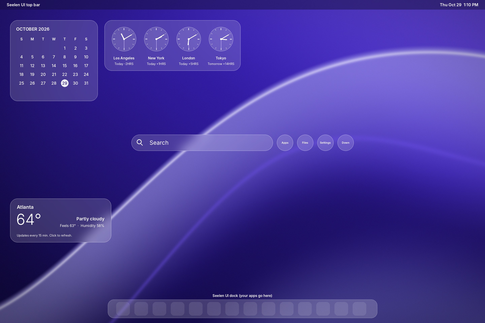

# GlassDesk for Surface Pro 8

A glass-style desktop for Windows 11 on a Surface Pro 8 (2880x1920, 200% scaling):
purple wave wallpaper, see-through widgets, and an optional dock with a top menu bar.



The preview is a mockup. On the real desktop the widgets are see-through but **not blurred**,
because Rainmeter can't blur what's behind it on Windows 11. The dock and top bar shown
are placeholders for Seelen UI, which has its own look.

## What you get

| Piece | What it is | Made by |
|---|---|---|
| Wallpaper | Original purple wave, sized exactly for the Surface screen | This folder |
| Calendar | Month grid, today circled | Rainmeter widget in this folder |
| World clocks | Los Angeles, New York, London, Tokyo, with correct daylight saving | Rainmeter widget in this folder |
| Weather | Current temp, condition, feels-like, humidity (from wttr.in, no account needed) | Rainmeter widget in this folder |
| Search bar | Click, type, press Enter to search your files. Buttons: Apps, Files, Settings, Downloads | Rainmeter widget in this folder |
| Dock + top bar | Optional, with `-WithDock` | Seelen UI (free) |

## Install

1. Quit PowerToys from the tray if it's running.
2. Open this `glassdesk` folder in File Explorer, right-click empty space, choose **Open in Terminal**.
3. Run:

```powershell
powershell -ExecutionPolicy Bypass -File .\Install-GlassDesk.ps1 -WithDock
```

Leave off `-WithDock` if you only want the wallpaper and widgets.
Add `-KeepTaskbar` if you don't want the Windows taskbar to auto-hide.

Windows will ask permission to install Rainmeter (and Seelen UI). Say yes.

### After it runs, if you used -WithDock
Open **Seelen UI** from Start. In its settings:
- turn **on** Dock and Toolbar
- turn **off** Window Manager, unless you want windows to tile themselves automatically

## Adjusting

Edit `Documents\Rainmeter\Skins\GlassDesk\@Resources\Variables.inc` in Notepad, save,
then right-click any widget and choose **Refresh skin**.

- Everything too big or small: change `Scale` (try 1.5 or 2.5)
- Text too big or small inside its box: change `FontScale` only
- Your city for weather: `WeatherLocation=Atlanta` (blank = detect automatically)
- Celsius: `WeatherUnits=m`
- Different world clocks: change `Clock1Name`, `Clock1Offset`, `Clock1DST`, and so on

Move a widget: drag it. Remove one: right-click it, **Unload skin**.

## Undo

```powershell
powershell -ExecutionPolicy Bypass -File .\Undo-GlassDesk.ps1
```

This puts back the wallpaper, transparency and taskbar settings you had before the
**first** install, and removes the widgets. Rainmeter and Seelen UI stay installed;
remove them in Settings > Apps if you want them gone.

## Recycle Bin and see-through desktop icons

Windows has no opacity setting for desktop icons. This script hides the real icons and
redraws your desktop shortcuts as a Rainmeter widget at about 50% opacity. Double-click to
open, same as before. Hovering an icon makes it solid.

```powershell
powershell -ExecutionPolicy Bypass -File .\Set-DesktopIcons.ps1
```

- Only hide the Recycle Bin: add `-RecycleBinOnly`
- Put everything back: add `-Restore`
- Change the opacity: edit `IconAlpha` (0 to 255), or the size: edit `IconScale` (1 = normal, 0.75 = smaller, 0.5 = half), in
  `Documents\Rainmeter\Skins\GlassDesk\Icons\Icons.ini`, then right-click the icons and choose **Refresh skin**

Custom icon for one item: put a PNG, ICO or JPG named exactly like the item (for example
`Beaucoup Banks.png`) in `Documents\Rainmeter\Skins\GlassDesk\@Resources\IconOverrides`.
It shows up within a couple of seconds.

Limits: it shows the first 12 items on your own Desktop folder. Shortcuts that Windows put
on the shared "Public" desktop for all users don't appear. Files you drop on the desktop show
up within a couple of seconds, but you can't drag icons onto exact spots.

## Live clock on a printed menu bar

For a wallpaper with a menu bar printed on it (the time baked into the image is erased first),
`Set-MenuBarClock.ps1` adds a live day, date and time in the same spot. Set the matching
wallpaper first, then run:

```powershell
powershell -ExecutionPolicy Bypass -File .\Set-MenuBarClock.ps1
```

Click the time to open the Windows calendar and notifications. If the text sits a little off,
edit `ClockX`, `ClockY` or `ClockSize` in `Documents\Rainmeter\Skins\GlassDesk\MenuClock\MenuClock.ini`
and choose **Refresh skin**.
